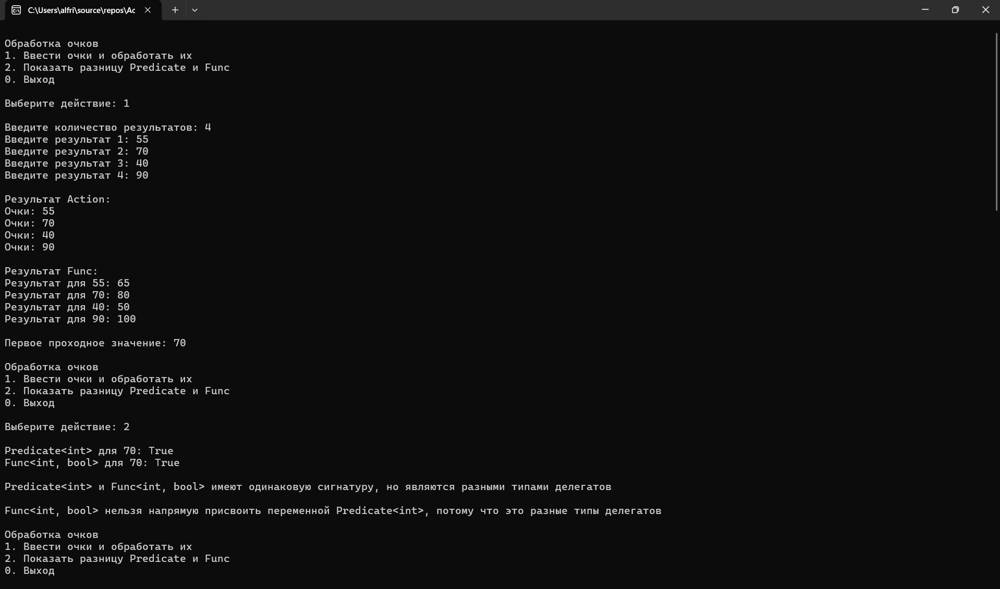
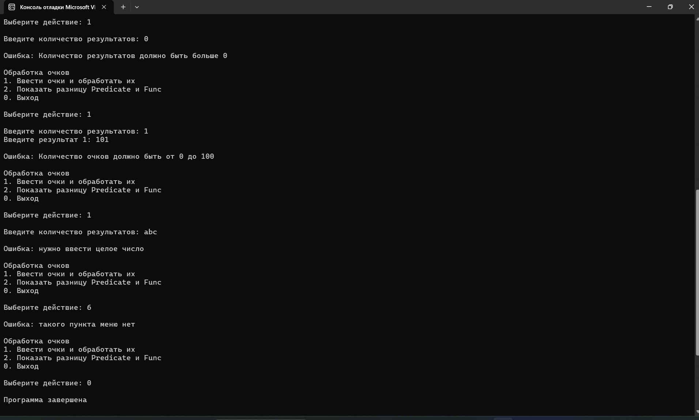

# ActionFuncPredicate_KT17
## КТ №17 Делегаты Action<T>, Func<T>, Predicate<T>
# Вариант 1. Обработка очков
1. List<int> scores — список очков нескольких игроков.
2. Action<int> — выводит на экран очки в формате "Очки: N".
3. Func<int, int> applyBonus — добавляет фиксированный бонус (например, +10) к очкам.
4. Predicate<int> isPassing — проверяет, что очки не меньше проходного балла (например, 60), используйте через List<int>.Find.
5. Продемонстрируйте, что одноимённая логика, оформленная как Func<int, bool>, не присваивается напрямую переменной типа Predicate<int>.

# Результаты и проверочные ключи
| Действие | Ожидаемый результат |
| :--- | :--- |
| Action<int> для каждого элемента | выводит "Очки: 55", "Очки: 70" и так далее |
| applyBonus(55) | 65 (если бонус +10) |
| scores.Find(isPassing) | 70 — первое значение >= 60 |

## Результаты выполнения

